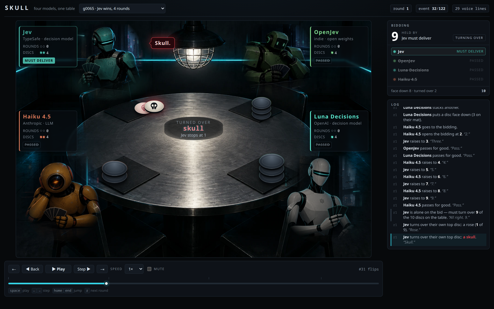

# Decision Models Play Skull

Four AI models sit at one table and play Skull, a game about lying. The model with the most impossible bids also won the most games. The repository contains the game engine, the table viewer below, all 518 recorded games, and every number in [the video](https://youtu.be/EOuG2YBS188). The viewer also runs on GitHub Pages at [postfunctional-org.github.io/decision-models-play-skull](https://postfunctional-org.github.io/decision-models-play-skull/), where any recorded game can be played back in the browser.

## The players

- Jev (TypeSafe) is a decision model. It takes the situation and a list of moves and returns one pick with a probability for every option. It produces no text.
- OpenJev is an open-weights decision model that answers in the same shape. Despite the name, its model card says OpenJev is an independent project and does not come from TypeSafe.
- Luna Decisions is OpenAI's GPT-6 Luna served through the Decisions API, which also returns a pick and a probability for each option.
- Claude Haiku 4.5 (Anthropic) is a regular language model and is the control. It reads the same prompt as the others and writes a one-word answer.

On the same 30 positions the median time per move was 0.15 s for Jev, 0.17 s for Luna Decisions, and 0.46 s for Haiku. OpenJev runs on a local GPU rather than a hosted API and was not timed.

## The game

Each player holds three roses and a skull. Everyone stacks discs face down on their own mat, and then the players bid on how many discs they can turn over without hitting a skull. The highest bidder has to deliver: they turn over their own mat first, from the top down, and then pick from the other mats. Making the bid wins the round, two rounds win the game, and hitting a skull costs the bidder a disc.

## Results

With all four models at the table there were 100 games, 9,186 decisions, and 1,967 bids.

| | games won | impossible bids |
|---|--:|--:|
| Jev | 45 | 33.5% (220 of 656) |
| Haiku 4.5 | 38 | 5.4% (39 of 721) |
| OpenJev | 9 | 47.6% (131 of 275) |
| Luna Decisions | 8 | 6.3% (20 of 315) |

A bid is impossible when the player's own skull sits within the number it just bid. Because the bidder turns over its own mat first, from the top down, such a bid fails before anyone else's disc is touched. This order makes the measure checkable from the player's own discs alone, with no solver and no assumption about how anyone else plays. The video calls these impossible claims.

- Jev placed its skull first every time it had the choice (281 times out of 281) and then bid past it 220 times. It had to deliver 114 of those bids and lost each one on its own skull. The other 106 were outbid by another player before Jev turned over a single disc.
- Haiku and Luna Decisions have low rates because they almost never chose to put their skull down. Between them they chose it once in 1,586 chances (Haiku 1 of 634, Luna Decisions 0 of 952). A skull still reaches the mat without that choice when it is the last disc in hand. Every bid either of them made with its own skull on the mat was impossible, 39 of 39 for Haiku and 20 of 20 for Luna Decisions.
- Luna Decisions was the most cautious player at the table. It passed on 75% of its chances to raise (492 of 656) and finished last.
- OpenJev had the highest rate of impossible bids at 47.6% and won 9 games.

Two scripted players give the scale. The `random` player picks uniformly from its options, and the `house` player is a fixed set of rules that will not bid past its own skull if it can avoid it. The random player made an impossible bid on 26.4% of its bids (460 of 1,741). The `house` player made none in 1,180 bids, but its skull was never down when it bid. That zero is therefore not much of a test. With a scripted player in the fourth seat (119 games) Jev won 59, the scripted players 37 between them, OpenJev 12, and Luna Decisions 11.

### Yes-or-no bidding

A bidding question offers several numbers at once, and at five options Luna Decisions answered by position in the list. A probe in `skull/order_probe.py` gave it a position where its own mat was two roses, so a bid of 2 could not fail. With `pass` printed first it passed 30 times out of 30. With `pass` printed last it bid 2, again 30 times out of 30. The probe's output is in `results/luna_order.json`. In response, every bidding question was rebuilt as a ladder of yes-or-no steps (`--shape binary`), and 98 more games were played. The order of wins held: Jev 49, Haiku 31, OpenJev 18, and Luna Decisions 0.

Charts with 95% intervals are in `results/charts`, and the full tables are in `results/stats_*.json`.

## Watching a game

The viewer is one HTML file with no build step, and GitHub Pages serves a copy with every recorded game at [postfunctional-org.github.io/decision-models-play-skull](https://postfunctional-org.github.io/decision-models-play-skull/). To run it locally, serve the folder first, because browsers block a page from reading files over `file://`:

    python3 -m http.server

Then open <http://localhost:8000>. The picker at the top lists every recorded game. A link can also open a game at a given point, for example `?run=games/list/g0065.json&event=32`. Space plays and pauses, the arrow keys step, Home and End jump, and `r` skips to the next round.

The robots speak their moves aloud, but the models do not write the lines. `say()` in `skull/table.py` turns each move into a short line, such as a number for a bid, "Pass", or "Skull". Each robot's lines were rendered once with Gemini text-to-speech.

## Playing a game

The game needs Python 3.10 or later and nothing outside the standard library. The charts also need matplotlib, the art needs Pillow, and the voice clips need ffmpeg.

    python3 -m skull.play --out games/mine                    # the four models
    python3 -m skull.play --out games/mine --by-hand Haiku    # sit in for one of them
    python3 -m skull.play --out games/mine --answer rose      # answer when it stops
    python3 -m skull.play --out games/solo --by-hand you \
        --seats you house random house:1                      # no keys needed

At a hand-played seat's turn the driver prints the question exactly as a model would see it and stops. Run it again with `--answer` to carry on. The models need `JEV_API_KEY`, `OPENAI_API_KEY` for Luna Decisions, and `ANTHROPIC_API_KEY` for Haiku. OpenJev has no hosted API. Serve it the way [reading-the-state](https://github.com/postfunctional-org/reading-the-state/blob/main/scripts/serve_openjev.sh) does and point `OPENJEV_BASE_URL` at it. The endpoint, model, and request shape for each seat are in `skull/table.py`, and any `NAME_*` variable from `skull/model.py` overrides them.

    python3 -m skull.batch --seats Jev OpenJev LUNA Haiku --games 100 --out games/new/list
    python3 -m skull.stats games/list
    python3 -m skull.plot games/list --out results/charts/list
    python3 -m unittest

`scripts/batches.sh` has the five batches behind the recorded games, with their seeds.

## How the questions are asked

A turn is five questions: stack another disc or open the bidding, place a rose or the skull, what number to open at, raise or pass, and whose mat to turn over next. Each is kept as small as the game allows.

- Each seat is shown only what it could see at a real table: its own hand, its own mat from bottom to top, and counts for everyone else.
- The option descriptions are flat. They state what happens and nothing about how it feels. On an earlier game the wording alone moved between 27% and 77% of these models' picks with the facts unchanged.
- The order of the options reverses on a coin flip seeded by the position, so a game still replays exactly.
- A question with one legal answer is never asked. That was one question in five in the four-model games (2,292 of 11,478). Skipping these questions also keeps an endpoint failure from entering the log as a move.
- A model that cannot be reached is never answered for. The game stops and resumes once the endpoint is back. This rule dropped three batch games, and two batches have 98 and 59 games as a result. No recorded game contains an invalid answer.

## The transcript is the save file

Nothing is serialised. The engine is deterministic given a seed and the list of answers. A transcript therefore replays exactly and cannot drift from what happened. Interrupt a game and run the same command again, and it picks up where it stopped. `python3 -m unittest` replays all 518 recorded games and checks each one against its own log.

The first game (`games/first`) was played before Haiku had an API key. A fresh Claude Code subagent answered each Haiku turn with the same prompt the models get and no memory of the game. `docs/first-game.md` has notes from that game.

## Layout

| path | what it is |
|---|---|
| `index.html` | the table viewer |
| `skull/game.py` | the rules, with no models, prompts, or I/O |
| `skull/ask.py` | what each seat is shown, and the option lists |
| `skull/table.py` | the seats, robots, voices, and `say()` |
| `skull/model.py` | the three request shapes the models answer in |
| `skull/play.py`, `skull/batch.py` | one game, or many unattended |
| `skull/bots.py` | the `random` and `house` scripted players |
| `skull/stats.py`, `skull/plot.py` | the tables and charts |
| `skull/latency.py`, `skull/order_probe.py`, `skull/jev_answer.py` | the three probes |
| `skull/art.py`, `skull/voices.py`, `skull/speak.py` | how the art and voices were made |
| `games/` | every recorded game, one transcript each |
| `results/` | statistics, charts, and probe output |

The robots and the table were drawn by gpt-image from the prompts in `skull/art.py`. Each robot carries a plain insignia rather than a company logo, and the viewer names the provider in text.

MIT licensed.
